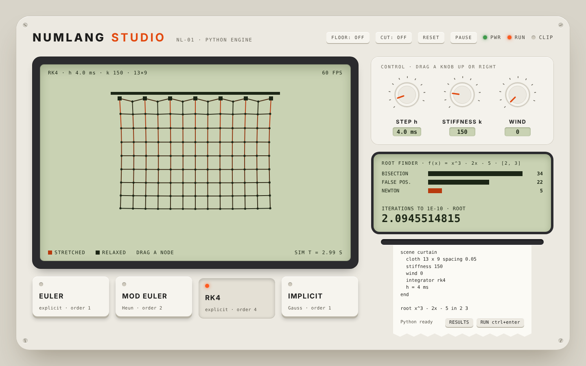
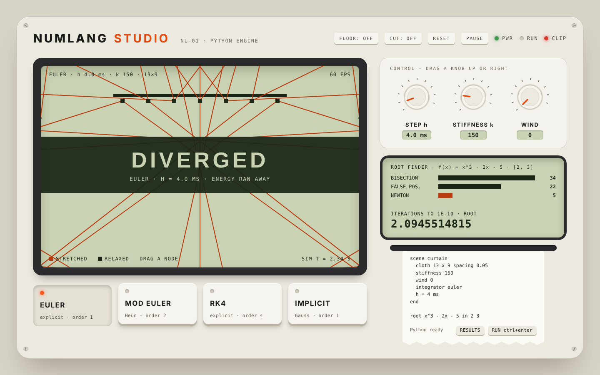
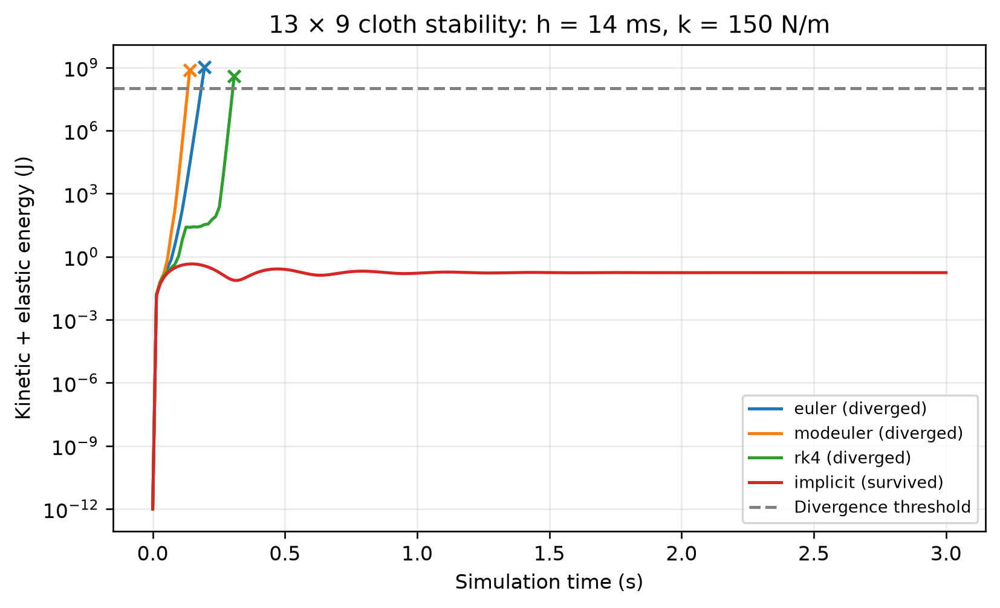

<div align="center">

# NUMLANG STUDIO

**A numerical methods laboratory you can interact with.**

[](https://github.com/gifari0017/NumLang-Studio/actions/workflows/tests.yml)
[](LICENSE)


</div>

A small mathematical language and interactive spring-mass simulator for Numerical Methods Laboratory (CSE-2204) at Bangladesh University of Professionals. Built with a Python numerical backend and an instrument-inspired browser interface.


*The Instrument interface: RK4, h = 4 ms. Everything on screen is computed by the Python engine.*


*Explicit Euler at the same step size: the energy runs away and the instrument flags DIVERGED.*

## What it demonstrates

- All nine course topics: analytical vs numerical comparison, Bisection, False Position, Newton-Raphson, Gaussian elimination, Gauss-Jordan, Euler, Modified Euler (Heun), and RK4.
- A handwritten lexer, recursive-descent parser, abstract syntax tree, dual-number automatic differentiation, symbolic differentiation, interpreter and REPL.
- A 13 × 9 cloth with 117 nodes, seven pins and 404 structural/shear springs; explicit and linearized implicit integrators, dragging, cutting and an optional floor.
- A dense, handwritten Gaussian elimination solver with partial pivoting, accelerated with Numba for the implicit step (220 free degrees of freedom initially).
- Scientific plots and iteration traces. NumPy supplies array storage/arithmetic, Numba compiles the loops, and Matplotlib draws results. Library solvers are used only in tests, never in the production algorithms.

## Quick start (Windows CMD)

Prerequisites: Git, uv, a system Python 3.14 installation. Verified on Windows 11 / Python 3.14.6.

```cmd
git clone https://github.com/gifari0017/NumLang-Studio.git
cd NumLang-Studio
uv sync --python-preference only-system
uv run python -m pytest -q
uv run python main.py
```

Open http://127.0.0.1:8765 if the browser does not open automatically. Keep CMD running, use a single browser tab and press Ctrl+C in CMD to stop. First execution may compile Numba kernels. Internet is not needed for calculations; external fonts have fallbacks.

## Language

```cmd
uv run python -m numlang
uv run python -m numlang examples/showcase.nl
```

Example program (also works in the Instrument paper tape; press Ctrl+Enter, then RESULTS):

```text
scene curtain
  cloth 13 x 9 spacing 0.05
  stiffness 150
  wind 0
  integrator rk4
  h = 4 ms
end
compare root x^3 - 2x - 5 in 2 3
compare solve [2 1 -1; -3 -1 2; -2 1 2] = [8 -11 -3]
compare ode y' = y, y(0) = 1, h = 0.1, to 1 exact exp(x)
trace root x^3 - 2x - 5 in 2 3 using newton
```

`root` defaults to all three methods; `solve` to Gauss; `ode` to RK4. `compare` runs all applicable methods. The ODE command is scalar, while the core also handles coupled systems. Exact ODE solutions are supplied by the user. `ln` and `log` both mean natural logarithm. `help` and `quit` work in the REPL.

## Measured results

Root of x³ − 2x − 5 on [2,3], tolerance 1e-10: 2.0945514815 (Bisection 34 iterations, False Position 22, Newton 5). The linear example returns [2, 3, −1]. For y′ = y, y(0) = 1, h = 0.1, at x = 1:

| Method | Numerical | Absolute error | Observed order (h .05 → .025) |
|---|---:|---:|---:|
| Euler | 2.5937424601 | 1.245394e-1 | 0.968 |
| Modified Euler | 2.7140808466 | 4.200982e-3 | 1.973 |
| RK4 | 2.7182797441 | 2.084324e-6 | 3.970 |

Exact: exp(1) = 2.718281828459.

### Cloth stability

3 s simulation, k = 150 N/m, no wind or floor, reset for each run; D = diverged, S = survived. Failure threshold: kinetic + spring elastic energy > 1e8 J or nonfinite state.

| h (ms) | Euler | Heun | RK4 | Implicit |
|---:|:---:|:---:|:---:|:---:|
| 1 | D | S | S | S |
| 3 | D | S | S | S |
| 4 | D | D | S | S |
| 10 | D | D | S | S |
| 14 | D | D | D | S |
| 33 | D | D | D | S |

These are finite-duration observations, not universal stability guarantees. For floor demonstration use RK4 at 4 ms, enable FLOOR, and pull/release a node toward the floor. Default clearance is 10 cm; resting contacts are not counted repeatedly. The hit time refers to a location inside a numerical step, not elapsed simulation time.



## Reproduce experiments

```cmd
uv run python experiments/demo_roots.py
uv run python experiments/demo_linear.py
uv run python experiments/demo_ode.py --trace
uv run python experiments/demo_cloth.py
uv run python -m numlang.app.plots
```

Plots are written to `docs/figures/`. All 249 tests pass on Windows 11 with Python 3.14.6 (5.94 s) and on Linux with Python 3.13 (machine dependent). Test references include exact solutions, NumPy and SymPy (only inside tests), finite differences, and HTTP integration checks.

## Architecture

```text
src/numlang/
  core/       roots.py, linear.py, linear_fast.py, ode.py
  lang/       lexer.py, parser.py, ast.py, dual.py, interpreter.py
  physics/    cloth.py, collision.py
  app/        server.py, instrument.html, plots.py
  __main__.py CLI / script runner
main.py       browser application launcher
examples/     sample NumLang program
experiments/  reproducible demos
tests/        pytest suites
docs/figures/ reproducible scientific plots
assets/       UI screenshots
.github/      automated test workflow
LICENSE       MIT license
```

The browser draws Python state and sends controls over local HTTP/JSON. It does not implement the numerical solvers. The implicit method is a single linearized step with a clamped transverse stiffness under compression; the floor uses linearly interpolated event detection and approximate rebound. No self-collision, friction, full nonlinear contact solve, or packaged executable is included.

## Testing and design notes

A GitHub Actions workflow runs the Python 3.14 test suite on a Windows runner after every push and pull request. The first run compiles Numba kernels, so it is slower. Local browser use is the supported deployment model; the server binds to loopback only and is not intended as a public production service.

## Contributors

- Nukhyai U Marma
- Abdus Salam Gifari

Department of Computer Science and Engineering, Bangladesh University of Professionals. Developed with AI-assisted coding and iterative verification.

## License

Released under the [MIT License](LICENSE).
